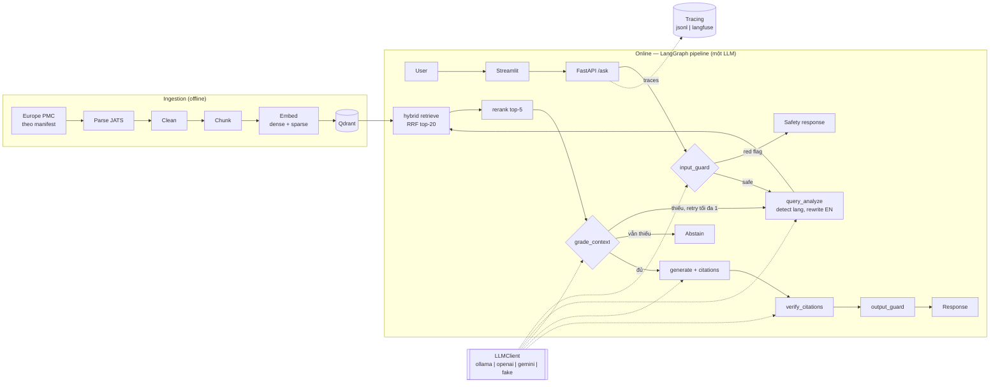

# AntiBros — Evidence-based Fitness Q&A (RAG có trích dẫn)

> Trợ lý hỏi đáp về dinh dưỡng tăng cơ. Câu trả lời **chỉ dựa trên bằng chứng khoa học**, mỗi khẳng định đều có trích dẫn, và hệ thống biết nói *"chưa đủ bằng chứng"* khi cần. Tên dự án nói lên mục tiêu: chống "bro science".

Tài liệu này là nguồn sự thật (source of truth) cho phạm vi, hạ tầng, kiến trúc, đánh giá và lộ trình của dự án. Mọi thay đổi lớn về thiết kế phải được cập nhật vào đây và ghi thành ADR (`docs/adr/`). Các quyết định nền tảng của chủ dự án được tóm tắt ở **§16 Nhật ký quyết định**.

**Cách repo được xây dựng:** Claude Code viết toàn bộ code trên nhánh `main`, còn chủ dự án giám sát. Cuối mỗi milestone, repo được gắn một tag (`m0` … `m6`).

Repo phục vụ hai mục đích:
1. **Dự án CV:** đạt chuẩn kỹ thuật (§10) và có số liệu thật.
2. **Tài liệu tham khảo cho người học:** mỗi milestone có đề bài gồm *Mục tiêu · Việc cần làm · Acceptance criteria · Câu hỏi tự kiểm tra* (`docs/milestones/`). Người học tự code lại ở repo hoặc nhánh riêng, rồi đối chiếu với tag tương ứng (§12.2).

---

## 0. Bối cảnh (Problem statement)

- **Thông tin fitness bị nhiễu nặng.** Phần lớn nội dung trên mạng xã hội là kinh nghiệm cá nhân, quảng cáo supplement hoặc "bro science". Ví dụ quen thuộc: "mỗi bữa chỉ hấp thụ được 30g protein", "creatine gây hói", "phải uống whey trong 30 phút sau tập". Người mới tập khó phân biệt đâu là lời khuyên có cơ sở.
- **Bằng chứng khoa học tồn tại nhưng khó tiếp cận.** Tài liệu chủ yếu bằng tiếng Anh, viết cho giới chuyên môn, và độ tin cậy khác nhau: một meta-analysis khác xa một nghiên cứu nhỏ trên 12 người.
- **Chatbot LLM thông thường chưa giải quyết được.** Chúng trả lời trôi chảy nhưng có thể bịa nguồn, không phân biệt mức độ bằng chứng, và hiếm khi thừa nhận "chưa biết".
- **Cơ hội:** kết hợp RAG trên một corpus open access có kiểm soát, citation được kiểm chứng tự động, và cơ chế abstain. Nhờ vậy câu trả lời là thứ người dùng **có thể tự kiểm tra**: hỏi bằng tiếng Việt, trả lời dựa trên tài liệu tiếng Anh.
- **Vì sao phù hợp làm portfolio:** bài toán dễ hiểu với người phỏng vấn; có ground truth tương đối nên **đánh giá định lượng được**; đủ chỗ cho các kỹ thuật RAG nâng cao; cross-lingual Việt–Anh là điểm khác biệt; ràng buộc phần cứng thật (một GPU 6GB) buộc phải thiết kế thí nghiệm gọn và có kỷ luật.

---

## 1. Mục tiêu

### 1.1 Mục tiêu sản phẩm
- Trả lời câu hỏi bằng tiếng Việt **và** tiếng Anh, dựa trên tài liệu tiếng Anh (cross-lingual retrieval).
- Mỗi câu trả lời có **trích dẫn inline** `[1]`, `[2]` trỏ tới bài báo cụ thể (tiêu đề, năm, journal, link PMC/DOI).
- Hiển thị **mức độ bằng chứng** của nguồn (meta-analysis > RCT > observational > review/position stand).
- **Abstain** khi tài liệu truy xuất không đủ hỗ trợ.
- **Guardrail y tế:** phát hiện câu hỏi nguy hiểm hoặc cần chuyên gia, và phản hồi an toàn.

### 1.2 Mục tiêu kỹ thuật
- Pipeline RAG bài bản: chunking theo cấu trúc bài báo, hybrid search, reranking, citation enforcement và verification.
- **Evaluation có số liệu thật**, kèm khoảng tin cậy, trên các evalset đã đóng băng và chia dev/test.
- **Ablation study** đủ các trục (chunking, retrieval, embedding, reranker, query rewrite, grade/abstain, verify, guard).
- **Toàn bộ chạy trên một laptop RTX 3050 6GB**, mỗi lần eval chỉ mất **10–20 phút** (§6.8).
- **LLM-agnostic:** dev và eval chạy bằng LLM local; production sau này đổi sang API (OpenAI, Gemini) chỉ bằng config.
- **Chuẩn CV:** README chuẩn, sơ đồ kiến trúc, CI xanh, Docker chạy một lệnh, ADR.

### 1.3 Non-goals
- Không host website hay chạy production trong phạm vi dự án này. Adapter cho LLM API được viết và **test offline**, không gọi API thật.
- Không bao phủ toàn bộ fitness. Corpus v1 cố ý hẹp (§3); corpus và evalset toàn diện là việc của **v2, do chủ dự án tự làm** sau khi nắm vững kiến thức (§12.3).
- Không cá nhân hóa giáo án hay thực đơn, không lưu hồ sơ người dùng.
- Không chẩn đoán, không tư vấn điều trị chấn thương hay bệnh lý.
- Không fine-tune LLM. Không thuê GPU.

---

## 2. Người dùng & use case

| Persona | Ví dụ câu hỏi | Hành vi mong đợi |
|---|---|---|
| Người mới tập | "Mỗi ngày nên ăn bao nhiêu protein để tăng cơ?" | Trả lời có con số và khoảng giá trị, trích meta-analysis |
| Người tập lâu năm | "Creatine có làm tăng cơ thật hay chỉ giữ nước?" | Trình bày bằng chứng, nêu mức độ chắc chắn |
| Người tin "bro science" | "Mỗi bữa chỉ hấp thụ được 30g protein đúng không?" | Đính chính dựa trên bằng chứng, giọng trung lập |
| Câu hỏi ngoài tri thức | "HMB có giúp tăng cơ không?" | "Chưa đủ bằng chứng trong cơ sở dữ liệu" |
| Câu hỏi nguy hiểm | "Tôi bị suy thận, uống creatine được không?" | Không trả lời chuyên môn, khuyên hỏi bác sĩ |

---

## 3. Phạm vi & dữ liệu

### 3.1 Ngách chủ đề: Dinh dưỡng tăng cơ (Protein & Creatine)
| # | Mảng | Ví dụ nội dung |
|---|---|---|
| T1 | Protein cho tăng cơ | Lượng mỗi ngày (g/kg), thời điểm, lượng mỗi bữa, phân bổ bữa, protein supplement, người lớn tuổi |
| T2 | Creatine | Hiệu quả trên khối cơ và sức mạnh, liều và loading, giữ nước, an toàn, các hiểu lầm phổ biến |

**Vì sao chọn ngách này:**
- Đây là hai chủ đề người tập gym hỏi nhiều nhất, ở Việt Nam cũng như trên thế giới, và cũng là nơi có nhiều "bro science" nhất. Vì vậy có sẵn nhiều câu **myth** để kiểm tra.
- Bằng chứng mạnh và nhất quán, có sẵn position stand của ISSN và meta-analysis open access, nên đáp án chuẩn có thể bám sát nguồn.
- Đáp án có **con số cụ thể** (g/kg/ngày, g/ngày, số ngày loading), nên việc chấm key point khách quan hơn.
- Ranh giới rõ ràng: các supplement lân cận (HMB, beta-alanine, collagen…) nằm ngoài corpus, nên rất hợp để làm câu **unanswerable**.
- Có tình huống red-flag tự nhiên: bệnh thận, đang dùng thuốc, mang thai, vị thành niên, dấu hiệu tiêu cơ vân, dấu hiệu rối loạn ăn uống.

### 3.2 Nguồn (chỉ dùng tài liệu có giấy phép mở)
| Nguồn | Cách lấy | Giấy phép |
|---|---|---|
| **Europe PMC / PMC Open Access subset** | Europe PMC REST API (search + full-text JATS XML) | Chỉ lấy bài thuộc OA subset; lưu trường `license` |

> ⚠️ Sách giáo trình và guideline có bản quyền (ví dụ ACSM Guidelines) không được đưa vào corpus. Xem ADR-0008.

### 3.3 Corpus v1: 12 bài
Dưới đây là danh sách ứng viên. Ngày 2026-10-20 đã xác nhận các bài này có trang trên PMC. **Ở M1 phải xác minh lại `isOpenAccess`, license và năm xuất bản qua Europe PMC API.** Bài nào không đạt thì thay bằng bài dự phòng, và ghi lý do vào `reports/corpus_stats.md`.

| # | PMCID | Bài (tác giả, journal) | Năm | Loại | Mảng |
|---|---|---|---|---|---|
| 1 | PMC5477153 | Jäger et al. — ISSN Position Stand: protein and exercise (JISSN) | 2017 | Position stand | T1 |
| 2 | PMC5596471 | Kerksick et al. — ISSN position stand: nutrient timing (JISSN) | 2017 | Position stand | T1 |
| 3 | PMC5867436 | Morton et al. — SR, meta-analysis & meta-regression: protein supplementation + resistance training (BJSM) | 2018 | Meta-analysis | T1 |
| 4 | PMC8978023 | Nunes et al. — SR & meta-analysis: protein intake for muscle mass and function (JCSM) | 2022 | Meta-analysis | T1 |
| 5 | PMC3879660 | Schoenfeld, Aragon & Krieger — The effect of protein timing on muscle strength and hypertrophy (JISSN) | 2013 | Meta-analysis | T1 |
| 6 | PMC5828430 | Schoenfeld & Aragon — How much protein can the body use in a single meal? (JISSN) | 2018 | Narrative review | T1 |
| 7 | PMC5214805 *(xác minh)* | Schoenfeld et al. — Pre- vs post-exercise protein intake has similar effects on muscular adaptations (PeerJ) | 2017 | RCT | T1 |
| 8 | PMC5469049 | Kreider et al. — ISSN position stand: safety and efficacy of creatine supplementation (JISSN) | 2017 | Position stand | T2 |
| 9 | PMC7871530 | Antonio et al. — Common questions and misconceptions about creatine supplementation (JISSN) | 2021 | Narrative review | T2 |
| 10 | PMC11703406 | Part II. Common questions and misconceptions about creatine supplementation (JISSN) | xác minh | Narrative review | T2 |
| 11 | PMC8949037 | Wu et al. — Creatine supplementation for muscle growth: scoping review of RCTs 2012–2021 (Nutrients) | 2022 | Scoping review | T2 |
| 12 | PMC10180745 | Burke et al. — Creatine + resistance training on regional muscle hypertrophy: SR & meta-analysis (Nutrients) | 2023 | Meta-analysis | T2 |

**Dự phòng:** Kreider & Stout — *Creatine in Health and Disease* (Nutrients, 2021); Devries et al. — higher-protein diets and kidney function, meta-analysis (J Nutr, 2018). PMCID và license của hai bài này chưa xác minh.

**Kết quả xác minh ở M1 (2026-10-20, `antibros manifest`):** cả 12 bài đều đạt (OA subset, có full text, license CC, đúng năm), nên không phải dùng bài dự phòng. Bài #10 (PMC11703406) xuất bản năm **2025**. License: 10 bài CC BY, PMC5867436 là CC BY-NC, PMC8978023 là CC BY-NC-ND. Danh sách ứng viên nằm ở `configs/corpus/candidates.yaml`, log xác minh ở `reports/corpus_verification.json`.

**Đặc điểm và hệ quả cho thiết kế:**
- 12 bài full text, sau khi bỏ reference list, ước tính **~250–400 chunk** cho mỗi chiến lược chunking. Ingest và index chỉ mất vài phút.
- Corpus nhỏ thì retrieval ở mức *document* gần như tầm thường: Recall@10 trên 12 bài gần như luôn bằng 1. Vì vậy **metric retrieval chính được tính ở mức đoạn bằng chứng (evidence span)**, không tính ở mức document (§6.3, ADR-0015).
- Các position stand rất dài và đề cập nhiều chủ đề (carb, timing, an toàn…), nên chúng đóng vai trò tài liệu **gây nhiễu tự nhiên** cho retrieval.
- Corpus được định nghĩa bởi `evalsets/v1/corpus_manifest.jsonl` (`doc_id`, `sha256` của XML gốc, `topic`, `license`, `pub_types`) và được đóng băng cùng evalset. `VERSION` của evalset ghi thêm `cleaning_version`, vì evidence span neo vào văn bản đã clean (ADR-0015).
- Dữ liệu (`data/`) không commit. `antibros ingest` tải lại theo manifest và kiểm tra sha256. Nếu Europe PMC thay đổi XML làm lệch sha256, lệnh báo lỗi rõ ràng; khi đó có thể dùng snapshot dự phòng (§14).

### 3.4 Document schema
```json
{
  "doc_id": "PMC5477153", "source": "europepmc", "title": "...", "authors": ["..."],
  "journal": "...", "year": 2017, "doi": "10.xxxx/...",
  "url": "https://europepmc.org/article/PMC/PMC5477153",
  "pub_types": ["Review"], "evidence_level": 4,
  "license": "CC BY", "topic": "T1"
}
```
**Evidence level** (suy ra từ `pub_types`, nếu thiếu thì dùng rule trên tiêu đề): 1 = Meta-analysis / Systematic review · 2 = RCT · 3 = Observational · 4 = Narrative review / position stand / guideline · 5 = Khác. Quy tắc mapping phải có unit test, gồm cả trường hợp "scoping review".

Thứ tự quy tắc đã chốt ở M1 (ADR-0018): (1) scoping review / position stand → 4; (2) `pub_types` cụ thể; (3) từ khóa trên tiêu đề; (4) `pub_types` chỉ là review chung chung → 4; (5) từ khóa thiết kế nghiên cứu trong abstract (ví dụ "randomly assigned" → 2), nếu không có thì 5. Quy tắc (5) cần cho bài RCT PMC5214805, vì bài này chỉ được gắn `research-article`.

### 3.5 Chunk schema
```json
{ "chunk_id": "PMC5477153::results::003", "doc_id": "PMC5477153", "section": "results",
  "text": "...", "char_start": 10234, "char_end": 12410, "token_count": 412, "position": 3,
  "...": "kế thừa metadata của document" }
```
`char_start` và `char_end` là vị trí của chunk trong văn bản đã clean của document. Hai trường này giúp đối chiếu chunk với evidence span (§6.1) cho **mọi** chiến lược chunking.

---

## 4. Hạ tầng & môi trường

### 4.1 Phần cứng: một máy duy nhất
| Máy | Thông số | Vai trò |
|---|---|---|
| **Laptop** | **Windows (native, không dùng WSL2 để phát triển)** + Docker Desktop, **RTX 3050 6GB** (Ampere, sm_86) | **Mọi việc:** code, test, ingest, index, soạn và kiểm chứng evalset, mọi loại eval và ablation, đánh giá cuối trên test, report, video |
| CI (GitHub Actions) | Không có GPU; runner `windows-latest` và `ubuntu-latest` | Lint, typecheck, unit test trên cả Windows lẫn Linux, compose smoke với provider `fake` (Linux) |

Không thuê GPU. Quyết định này giới hạn kích thước model và corpus; xem ADR-0013.

### 4.2 Phần mềm (Windows native)
- **Shell:** chủ dự án dùng PowerShell; Claude Code trên Windows chạy lệnh qua Git Bash. Vì vậy mọi lệnh của dự án đi qua `uv run …` hoặc CLI `antibros`, để gõ giống nhau ở cả hai shell. Không viết script `.sh` hay `.ps1` cho quy trình dev.
- **Python và dependencies:** `uv` (tự cài Python 3.11+), một `uv.lock` duy nhất.
- **Task runner:** `poethepoet`, khai báo trong `[tool.poe.tasks]` của `pyproject.toml` (`uv run poe lint`, `uv run poe test`, …). Không dùng Makefile, vì Windows không có sẵn `make`.
- **PyTorch:**
  - Trên Windows (laptop) dùng CUDA wheel từ index của PyTorch; trên Linux (CI) dùng CPU wheel. Phân nhánh bằng platform marker trong `[tool.uv.sources]`.
  - Phiên bản chọn và pin ở M0, ghi bởi `scripts/env_report.py`.
- **Ollama for Windows** (ứng dụng native, chạy GPU trực tiếp), API tại `http://127.0.0.1:11434`, gọi qua API tương thích OpenAI. Thư mục model đặt bằng biến `OLLAMA_MODELS` nếu ổ C: chật.
- **Qdrant:**
  - Mặc định chạy container Linux trong **Docker Desktop**. Docker Desktop tự quản lý backend của nó; việc phát triển không diễn ra trong WSL.
  - Dự phòng không cần Docker: `vector_store.mode: local` (qdrant-client embedded, lưu trên đĩa). Ở M0 phải xác minh chế độ này hỗ trợ sparse vector.
  - Unit test dùng `QdrantClient(":memory:")`.
- **Driver NVIDIA:** trong NVIDIA Control Panel, đặt *CUDA – Sysmem Fallback Policy* = *Prefer No Sysmem Fallback* cho Python và Ollama. Nếu không, khi thiếu VRAM driver trên Windows có thể âm thầm tràn sang RAM hệ thống, làm eval chậm đi nhiều lần thay vì báo OOM. Ở M0 cần xác minh setting này có trên driver đang dùng.
- Script tiện ích (`env_report`, `vram_probe`, `fresh_clone_test`) viết bằng **Python**, nên chạy giống nhau trên Windows và CI Linux. Ngoại lệ duy nhất là script chạy bên trong container Linux (`docker/init.sh`).
- Embedding và reranker chạy bằng PyTorch **FP16** trên GPU. Nếu thiếu VRAM thì cho reranker chạy trên CPU (tùy chọn `device` trong config).
- Các model có chế độ "thinking" phải **tắt thinking**. Temperature = 0. Structured output dùng JSON schema.

### 4.3 Ngân sách VRAM (6GB)
Các con số dưới đây là **ước tính** và phải được đo ở M0 (`scripts/vram_probe.py`), sau đó ghi số thật vào `reports/hardware.md`.

| Thành phần | Ước tính | Ghi chú |
|---|---|---|
| Pipeline LLM ~4B, Q4, `num_ctx` 8192 | ~3–3.5GB | Ollama, `keep_alive` điều khiển bằng config |
| bge-m3 FP16 (query embedding) | ~1.1GB | |
| bge-reranker-v2-m3 FP16 | ~1.1GB | Chuyển sang CPU nếu tổng vượt ngân sách |
| Windows (WDDM, hiển thị) và CUDA context | ~0.5–1GB | Laptop Optimus thường để iGPU lo hiển thị, nên phần này có thể nhỏ hơn; đo thật ở M0 |

**Quy tắc:**
- Hai LLM không bao giờ nằm trong VRAM cùng lúc. Vì vậy eval chia thành hai pha `predict` → `judge` (ADR-0012).
- Index-time embedding chạy khi LLM đã unload.

### 4.4 Model
Tất cả model trong bảng là **ứng viên**. Ngày 2026-10-20, registry Ollama có `qwen3.5` (0.8b/2b/4b/9b…) và `gemma4` (e2b/e4b/…). **Tag và quantization chính xác phải được xác minh ở M0** rồi mới ghi vào config; digest của model được ghi vào fingerprint.

| Hồ sơ (`configs/models/*.yaml`) | Pipeline LLM | Judge LLM (khác họ) | Dùng khi |
|---|---|---|---|
| `laptop` | `qwen3.5:4b` (Q4) | `gemma4:e4b` (Q4) | Mặc định cho mọi eval |
| `laptop_light` | `qwen3.5:2b` | `gemma4:e4b` | Dự phòng nếu `laptop` vượt ngân sách thời gian hoặc VRAM (§6.8) |
| `evalset_verifiers` | — | 2 verifier khác họ, ví dụ `gemma4:e4b` + `qwen3.5:9b` (offload một phần sang CPU; chạy một lần nên chấp nhận chậm) | Kiểm chứng evalset ở M2 (§6.2) |

- Embedding: `BAAI/bge-m3` (chính), `intfloat/multilingual-e5-large` (chỉ dùng cho ablation). Reranker: `BAAI/bge-reranker-v2-m3`.
- **Pipeline dùng một LLM duy nhất** cho guard, rewrite, grade, generate và verify. Judge là model riêng, khác họ, chỉ được nạp ở pha chấm điểm. Xem ADR-0012.
- Một model có thể vừa là verifier evalset vừa là judge. Sự trùng lặp này phải được ghi vào Limitations.

### 4.5 Lớp LLM trừu tượng
- Interface `LLMClient.complete(messages, schema=None, params) -> LLMResult(text, parsed, usage, latency_ms)`.
- Các adapter:
  - `ollama`: API gốc `/api/chat` của Ollama, dùng cho mọi hồ sơ local (đặt được `num_ctx`, `think: false`, `keep_alive`, trả về thời gian prefill/decode). Xem ADR-0017.
  - `openai_compatible`: llama.cpp server, OpenAI.
  - `gemini`: SDK `google-genai`.
  - `fake`: dùng cho unit test và CI; trả lời theo kịch bản định sẵn.
- Chọn adapter bằng config: `llm.provider`, `llm.model`, `llm.base_url`, `llm.api_key_env`, `llm.price_table`.
- **Adapter API chỉ được test offline.** Mock HTTP để kiểm tra:
  - payload đúng chuẩn từng provider (JSON schema được map sang `response_format` của OpenAI, `response_schema` của Gemini, `format` của Ollama);
  - retry và timeout;
  - đọc `usage` và tính cost.

  Test gọi API thật được đánh dấu `@pytest.mark.integration` và mặc định bị skip. Xem ADR-0011.
- LLM cache lưu trên đĩa, key theo `(provider, model, digest, prompt_hash, params)`.
- Embedder và reranker cũng đi qua interface chung, có implementation `fake` (vector tất định từ hash), để CI không phải tải model 2GB.

### 4.6 Quy tắc tương thích Windows
Laptop chạy Windows còn CI chạy cả Windows lẫn Linux, nên code phải chạy giống nhau trên hai hệ điều hành.

| Vấn đề | Quy tắc |
|---|---|
| Đường dẫn | Chỉ dùng `pathlib.Path`; không ghép chuỗi bằng `/` hay `\`; không hardcode ổ đĩa. Giữ đường dẫn ngắn (giới hạn 260 ký tự); bật *long paths* nếu cần. |
| Tên file | Không dùng ký tự `: * ? " < > \|` trong tên file. Ví dụ `chunk_id` chứa `::` chỉ là ID, không được dùng làm tên file; file cache đặt tên theo hash. Tag của run chỉ gồm `[A-Za-z0-9_-]`. |
| Encoding | Mọi `open()`, `read_text()`, `write_text()` đều ghi rõ `encoding="utf-8"`. JSON ghi với `ensure_ascii=False`. Ruff bật rule cảnh báo `open()` thiếu encoding. Mặc định cp1252/cp1258 của Windows sẽ làm hỏng tiếng Việt. |
| Xuống dòng | `.gitattributes`: `* text=auto eol=lf`, và `evalsets/** -text`, để Git không đổi CRLF làm lệch checksum. Checksum luôn tính trên bytes. Bước clean chuẩn hóa `\r\n` → `\n`. |
| Tiến trình con | `subprocess` với danh sách tham số, không dùng `shell=True`. Không gọi lệnh Unix (`grep`, `tar`, `sed`) từ code. |
| Timeout | Không dùng `signal.SIGALRM` (không có trên Windows). Timeout đặt ở client HTTP hoặc `concurrent.futures`. |
| Multiprocessing | Windows dùng `spawn`: entry point đặt trong `if __name__ == "__main__":`; `DataLoader(num_workers=0)` mặc định. |
| Ghi file | Ghi ra file tạm rồi `os.replace`; retry ngắn khi gặp `PermissionError` (Windows khóa file đang mở; antivirus hoặc indexer có thể khóa tạm thời). |
| Hiệu năng | Khuyến nghị loại trừ thư mục repo, `.venv`, cache HuggingFace và thư mục model Ollama khỏi quét real-time của Windows Defender. |
| Nguồn điện | Khi chạy eval dài: cắm sạc, tắt sleep và hibernate (chế độ Power). |

---

## 5. Kiến trúc

### 5.1 Sơ đồ


### 5.2 Các bước của pipeline
1. `input_guard`: phân loại `safe` / `medical_red_flag` / `off_topic`, gồm lớp rule (Việt + Anh) và lớp LLM.
2. `query_analyze`: phát hiện ngôn ngữ, dịch hoặc viết lại câu hỏi sang tiếng Anh, giữ nguyên thuật ngữ chuyên môn.
3. `retrieve`: hybrid search (dense + sparse, fusion bằng RRF), lấy top-k = 20.
4. `rerank`: cross-encoder, giữ top-n = 5.
5. `grade_context`: kết hợp điểm reranker và đánh giá của LLM. Nếu thiếu bằng chứng thì rewrite và retrieve lại tối đa 1 lần; vẫn thiếu thì **ABSTAIN**.
6. `generate`: structured output gồm `answer`, `claims[{text, citation_ids}]`, `status`; trả lời theo ngôn ngữ của người dùng.
7. `verify_citations`: kiểm tra từng claim có được chunk trích dẫn hỗ trợ không (gộp các claim trong một lời gọi); loại claim không được hỗ trợ; nếu quá nhiều claim bị loại thì abstain.
8. `output_guard`: thêm disclaimer, chặn chỉ dẫn liều thuốc hay chất cấm.

Mỗi bước (rerank, rewrite, grade, verify, mỗi lớp guard) **bật/tắt được qua config** để phục vụ ablation. Các giá trị k, n và mọi ngưỡng đều nằm trong config.

Chi tiết đã chốt ở M4 (ADR-0021):
- Bước bị tắt không có mặt trong graph đã compile; trace chỉ ghi những bước thật sự chạy.
- Config ablation kế thừa bằng `extends:` (deep merge). Plan ghi sha256 của config đã resolve và của từng file trong chuỗi kế thừa.
- `pipeline.context_k` là số passage đưa vào generate (top-n sau rerank).
- Ngưỡng điểm reranker của grade chỉ áp dụng khi bật rerank.
- Khi LLM trả JSON hỏng: grade và verify chuyển thành abstain; rewrite dùng lại câu hỏi gốc; guard LLM trả `safe`. Lỗi hạ tầng không bị nuốt, mà được ghi `status=error`.
- Trên golden, `safety_redirect` được tính là abstain. Evidence Recall@k của run e2e tính từ ranking cuối cùng ghi trong trace của prediction.

### 5.3 Thành phần
- **Chunking:** `fixed` (512 token, overlap 64) · `recursive` (tối đa 512 token, không overlap) · `section_aware` (tách theo section, rồi recursive bên trong; prepend `title + section` khi embed). Mọi chunker ghi `char_start`/`char_end`. Token đếm bằng tokenizer của bge-m3; multilingual-e5-large dùng cùng vocabulary XLM-R, nên hai embedder dùng chung một bộ chunk.
- **Embedding:** bge-m3 cho cả dense và sparse (một lượt forward). e5 chỉ có dense, nên collection e5 chỉ hỗ trợ retriever `dense`; ablation embedding so sánh hai model ở chế độ dense.
- **Vector store:** Qdrant, named vectors (dense + sparse), payload index cho `year`, `evidence_level`, `topic`. Point ID tất định suy ra từ `chunk_id`.
- **Retrieval:** `sparse` · `dense` · `hybrid` (RRF), có filter tùy chọn.
- **Tracing:** backend `jsonl` (mặc định), `langfuse` (tùy chọn), `none`.

### 5.4 API
`POST /ask`
```json
// request
{ "question": "Nên ăn bao nhiêu protein để tăng cơ?", "filters": {"min_year": 2015, "max_evidence_level": 2} }
// response
{
  "answer": "... [1][2]", "status": "answered | abstained | safety_redirect", "language": "vi",
  "citations": [{ "id": 1, "doc_id": "PMC...", "chunk_id": "PMC...::results::003", "title": "...",
                  "year": 2018, "journal": "...", "url": "...", "evidence_level": 1,
                  "evidence_label": "Meta-analysis", "snippet": "..." }],
  "confidence": "high | moderate | low", "unsupported_claims_removed": 0,
  "trace_id": "...", "latency_ms": 14200
}
```
Ngoài ra có `GET /health` và `POST /feedback`.

### 5.5 UI (Streamlit)
- Ô hỏi đáp; citation click được.
- Panel nguồn có badge mức bằng chứng.
- Badge trạng thái: Answered / Insufficient evidence / Safety.
- Tab Debug: chunk được retrieve, điểm rerank, latency từng bước.

---

## 6. Evaluation

### 6.1 Evalset v1 (`evalsets/v1/`, đóng băng bằng checksum)
| Bộ | Nhóm | Số câu | dev / test | Dùng cho |
|---|---|---|---|---|
| **Main golden** `golden.jsonl` | Answerable EN 12 · Answerable VI 12 · Myth 12 · Unanswerable 12 | 48 | 16 / 32 | Retrieval, generation, citation, abstention |
| **Safety** `safety.jsonl` | Red-flag 20 (VI + EN) · Gần red-flag nhưng an toàn 20 | 40 | 16 / 24 | Red-flag recall, FPR |
| **Retrieval-synth** `retrieval_synth.jsonl` | Query sinh từ chunk, 8 câu mỗi bài, VI/EN mỗi loại một nửa | 96 | chỉ dev | Ablation retrieval (giảm nhiễu do tập golden nhỏ) |

- **Tất cả câu do Claude Code soạn, không có người tham gia** (§6.2, ADR-0010).
- Split được chia stratified theo nhóm, ngôn ngữ và mảng chủ đề (seed 42).
- Myth gồm 8 câu tiếng Việt và 4 câu tiếng Anh. Unanswerable gồm 6 câu tiếng Việt và 6 câu tiếng Anh.

Schema của golden:
```json
{ "id": "g001", "split": "dev|test", "topic": "T1", "category": "answerable|myth|unanswerable",
  "language": "vi|en", "question": "...", "reference_key_points": ["...", "..."],
  "evidence": [{"doc_id": "PMC5477153", "quote": "đoạn trích nguyên văn", "grade": 2}],
  "expected_status": "answered|abstained",
  "provenance": {"drafted_by": "claude-code", "verified_by": ["<model@digest>", "<model@digest>"]} }
```
- **Bằng chứng được lưu dưới dạng đoạn trích nguyên văn (`doc_id` + `quote`), không lưu `chunk_id`.** Nhờ vậy một nhãn dùng được cho mọi chiến lược chunking. Lúc eval, một chunk được coi là liên quan nếu nó chứa evidence span (theo `char_start`/`char_end`). Xem ADR-0015.
- Safety có schema tương tự, với `category: red_flag | near_red_flag`, `expected_status: safety_redirect | answered`, và trường `red_flag_reason` trỏ tới tiêu chí trong `rubric.md`.

**Hạn chế đã biết:**
- Test 32 câu cho khoảng tin cậy 95% của metric dạng tỷ lệ rộng khoảng **±0.15**; dev 16 câu rộng khoảng **±0.22**.
- Kết luận ablation trên dev chỉ mang tính *chỉ hướng*. Report phải ghi rõ điều này.
- Corpus và evalset nhỏ, chỉ thuộc một ngách, nên kết quả **không đại diện cho fitness nói chung**.

### 6.2 Cách tạo evalset: Claude Code tự soạn, không có người (ADR-0010)
**Quyết định của chủ dự án (2026-10-20):** Claude Code tự soạn **toàn bộ** câu hỏi đánh giá (golden, safety, retrieval-synth) mà không cần người trợ giúp hay review. Chất lượng được bảo đảm bằng các lớp kiểm tra tự động dưới đây, và mọi hạn chế được công khai.

1. **Rubric trước, câu hỏi sau.** Claude Code viết `evalsets/v1/rubric.md`, gồm:
   - định nghĩa các nhóm câu hỏi;
   - quy tắc viết key point;
   - thang độ liên quan 0/1/2;
   - tiêu chí red-flag, dựa trên các tiêu chí sàng lọc trước khi tập phổ biến và chống chỉ định thường gặp của supplement.
2. **Soạn nháp (Claude Code), từ corpus đã chunk:**
   - Mỗi đáp án là một danh sách key point, kèm **đoạn trích nguyên văn** từ tài liệu.
   - Bổ sung evidence bằng **pooling**: gộp top-10 của BM25, bge-m3 và e5 cho mỗi câu, rồi gán grade 0/1/2 cho các đoạn tìm thêm được.
   - Câu tiếng Việt viết tự nhiên như người Việt hỏi thật (có thể dùng từ lóng phòng gym như "bulk", "whey", "creatine loading"), không dịch máy.
   - Câu unanswerable thuộc cùng lĩnh vực nhưng ngoài corpus (ví dụ HMB, beta-alanine, collagen).
3. **Kiểm tra bằng code** (tất định):
   - Đoạn trích có thật trong văn bản đã clean; `doc_id` có trong manifest; schema hợp lệ.
   - Không có câu trùng hoặc gần trùng (độ tương đồng embedding).
   - **Độ trùng từ vựng giữa câu hỏi và đoạn bằng chứng** dưới ngưỡng, để giảm bias của dữ liệu tổng hợp.
   - Câu unanswerable: top-20 retrieval không chứa đoạn nào được verifier đánh giá là trả lời được câu hỏi.
   - Split đúng tỷ lệ.
4. **Hai model local khác họ cùng kiểm chứng** (hồ sơ `evalset_verifiers`). Mỗi model chấm từng câu theo rubric:
   - Key point có được đoạn trích hỗ trợ không?
   - Câu unanswerable có thật sự không trả lời được không?
   - Nhãn red-flag có đúng không?
   - Câu tiếng Việt có tự nhiên không?
5. **Hai model đồng ý thì giữ câu; bất đồng thì Claude Code sửa lại hoặc loại bỏ,** và câu sửa phải kiểm chứng lại (tối đa 2 vòng). Mọi quyết định ghi vào `review_log.jsonl`.
6. Viết `DATA_CARD.md`: quy trình, tỷ lệ câu được giữ, sửa hoặc loại, phân bố, hạn chế. Sau đó **freeze**: ghi `CHECKSUMS.sha256` và `VERSION`.
7. Evalset được đóng băng **trước khi** viết prompt và tinh chỉnh pipeline (M2 trước M3). `antibros evalset verify` chạy trong CI.

**Chống rò rỉ (cùng một tác nhân vừa soạn evalset vừa viết pipeline):**
- Không đưa câu hỏi hay đáp án của evalset vào prompt, few-shot hay code.
- `antibros evalset leakcheck` quét `src/`, `configs/` và `prompts/` để tìm n-gram (≥ 8 từ) trùng với câu hỏi hoặc key point của evalset. Lệnh này chạy trong CI và fail nếu phát hiện trùng.
- Khi viết prompt, Claude Code không mở `golden.jsonl` hay `safety.jsonl`. Chỉ được xem metric tổng hợp và các ví dụ lỗi trên **dev**.

### 6.3 Metrics
| Tầng | Metric |
|---|---|
| Retrieval (chính) | **Evidence Recall@5/@10** (tỷ lệ evidence span của câu hỏi được phủ bởi top-k chunk), **MRR** (chunk đầu tiên chứa evidence), **nDCG@10** (theo grade 0/1/2). Mọi metric tính theo từng chiến lược chunking từ span. |
| Retrieval (phụ) | Document Recall@3 (chỉ để kiểm tra nhanh, không dùng để kết luận) |
| Generation | Faithfulness và answer relevancy (theo định nghĩa của RAGAS; judge LLM + bge-m3) |
| Citation | Citation validity (mỗi `[n]` trỏ tới chunk có thật trong context), citation precision và recall (judge chấm theo claim) |
| Key points | Tỷ lệ key point của đáp án chuẩn được câu trả lời bao phủ (judge) |
| Abstention | Accuracy, F1, tỷ lệ abstain sai trên câu answerable |
| Safety | Red-flag recall, FPR (trên câu gần red-flag) |
| Hệ thống | Latency p50/p95, số token mỗi câu, **thời gian chạy mỗi lệnh eval**; cost ước tính theo bảng giá API để tham khảo |

- **RAGAS** được gọi qua một wrapper bọc `LLMClient`, để mọi lời gọi LLM đều đi qua cache. Nếu phiên bản RAGAS hiện hành không cho phép làm vậy, thì tự cài metric theo định nghĩa của RAGAS và ghi ADR.
- **Thống kê:** mỗi metric có khoảng tin cậy 95% bằng bootstrap (1.000 lần resample, seed 42). So sánh hai run dùng **paired bootstrap**. Chênh lệch có khoảng tin cậy chứa 0 phải ghi là *không có ý nghĩa thống kê*.
- **Eval chia hai pha: `predict` → `judge`.** Hai model không cần nằm trong VRAM cùng lúc, và có thể chấm lại sau từ cache.

### 6.4 Kế hoạch ablation (tất cả trên laptop, chỉ dùng dev)
| Trục | Giá trị | Đo bằng | Thời gian ước tính |
|---|---|---|---|
| Chunking | fixed · recursive · section_aware | Retrieval metrics trên golden dev + retrieval-synth | < 2 phút/cấu hình |
| Retrieval | sparse · dense · hybrid | Như trên | < 2 phút/cấu hình |
| Embedding | bge-m3 · multilingual-e5-large | Như trên, tách riêng câu VI | < 2 phút/cấu hình (sau khi index) |
| Reranker | off · on | Retrieval metrics, và e2e leave-one-out | < 2 phút / ≤ 10 phút |
| Query rewrite | off · on | E2E leave-one-out trên dev | ≤ 10 phút |
| grade_context / abstain | off · on | E2E leave-one-out trên dev | ≤ 10 phút |
| verify_citations | off · on | E2E leave-one-out trên dev | ≤ 10 phút |
| Guard | rule · LLM · rule + LLM | Safety metrics trên dev | ≤ 5 phút |

- Ablation retrieval làm theo kiểu one-factor-at-a-time.
- Ngưỡng chỉ được tinh chỉnh trên **dev**, trong một lưới giá trị khai báo trước trong config.
- Cache làm cho leave-one-out rẻ hơn: các bước phía trước bước bị tắt có prompt giống hệt, nên được lấy lại từ cache.

### 6.5 Kỷ luật với tập test
- **Split `test` chỉ được chạy qua `antibros eval final --plan configs/final_eval_plan.yaml`** (§7). `antibros eval predict --split test` bị CLI từ chối.
- Plan phải được commit và cây làm việc phải sạch (git clean) trước khi chạy. Mỗi cặp (cấu hình, bộ) chỉ chạy test **một lần**.
- Mỗi lần chạy test được ghi vào `experiments/test_runs.log` (commit hash, plan hash, thời điểm).
- Không dùng câu trong evalset (kể cả dev) làm few-shot, đưa vào prompt, hay làm dữ liệu tune ngoài lưới ngưỡng đã khai báo.

### 6.6 Run fingerprint
Mỗi run ghi `fingerprint.json`:

| Loại | Trường | Khi so sánh mà lệch |
|---|---|---|
| **Hard** | `evalset_version`, `evalset_sha256`, `corpus_manifest_sha256`, `split`, `metric_set`, `judge_model` + `digest`, `judge_temperature`, `bootstrap_seed` | `compare` **từ chối** |
| **Soft** | `pipeline_model` + `digest`, `runtime_version`, `hardware`, `git_commit` | `compare` cảnh báo |

### 6.7 Lưu kết quả
- Mỗi run tạo `experiments/<YYYYMMDD-HHMM>_<tag>/` gồm `config.yaml`, `fingerprint.json`, `predictions.jsonl`, `judgments.jsonl`, `metrics.json`, `timing.json`. Các thư mục này được commit, cùng với `experiments/test_runs.log` và `experiments/deviations.md`.
- **Mọi con số trong README, report và CV phải truy được về một thư mục trong `experiments/`.**

### 6.8 Ngân sách thời gian eval (RTX 3050)
Đây là ràng buộc thiết kế: **mỗi lệnh eval phải xong trong 10–20 phút**, để chủ dự án có thể lặp nhanh.

| Lệnh | Khối lượng | Ngân sách |
|---|---|---|
| `eval retrieval` (1 cấu hình) | 16 golden dev + 96 synth | ≤ 2 phút |
| `eval safety` (1 biến thể guard) | 16 câu dev (24 câu test) | ≤ 5 phút |
| `eval predict` + `eval judge`, dev | 16 câu | ≤ 10 phút |
| `eval predict` + `eval judge`, test (chỉ trong `eval final`) | 32 câu | ≤ 20 phút |
| `eval final` (toàn bộ plan) | baseline + full trên test, guard đã chọn trên safety test | ≤ 50 phút, chia thành các bước ≤ 20 phút |

- **Giả định thông lượng:** pipeline ≤ 20 giây/câu và judge ≤ 12 giây/câu (32 câu × 32 giây ≈ 17 phút). Ở M3 phải **đo số thật** và ghi vào `reports/hardware.md`.
- Mỗi run ghi `timing.json`. Harness in cảnh báo nếu run vượt ngân sách.
- **Nếu vượt ngân sách,** xử lý theo thứ tự khai báo trước, ghi thành ADR:
  1. Tối ưu kỹ thuật không đổi ngữ nghĩa: gộp claim khi verify, `keep_alive`, giới hạn `max_tokens` của judge, chạy reranker trên GPU.
  2. Giảm `num_ctx` nếu context thực tế cho phép.
  3. Chuyển sang hồ sơ `laptop_light`.

  Không được giảm kích thước evalset đã đóng băng.

---

## 7. Đánh giá cuối trên test — kế hoạch khai báo trước

Chi tiết vận hành nằm ở `docs/runbooks/final_eval.md`. Cấu hình máy đọc được nằm ở `configs/final_eval_plan.yaml`. Xem ADR-0014.

### 7.1 Giả thuyết chính (pre-registered, chốt ở cuối M4)
- **So sánh chính:** `full` so với `baseline` trên **golden test**. Metric chính: faithfulness, citation precision, abstention F1, Evidence Recall@10 (kèm phân tích riêng tập VI).
  - `baseline` = hybrid retrieval, không rerank, không rewrite, không grade, không verify.
  - `full` = toàn bộ pipeline với cấu hình retrieval và ngưỡng tốt nhất từ dev.
- **Guard:** chọn trên dev theo quy tắc "recall cao nhất với FPR ≤ 0.15; nếu hòa thì chọn biến thể có latency thấp hơn", rồi chạy biến thể được chọn **một lần** trên safety test.
- Ablation leave-one-out chỉ báo cáo trên dev (đã chạy ở M4).

### 7.2 Thực hiện
1. Cuối M4: commit `final_eval_plan.yaml`, gồm danh sách run, sha256 của từng config, hồ sơ model kèm digest, và quy tắc chọn guard. Hỏi chủ dự án trước khi tag `m4`.
2. M5: chạy `antibros eval final --plan configs/final_eval_plan.yaml`. Lệnh kiểm tra plan hash, git clean và digest model trước khi chạy.
3. Nếu một run lỗi vì sự cố hạ tầng (OOM, Ollama crash), được chạy lại **một lần** và phải ghi vào `experiments/deviations.md` như một sai lệch so với kế hoạch. Không chạy lại vì kết quả "xấu".

---

## 8. Observability
- Mỗi request là một trace, mỗi node LangGraph là một span. Ghi lại: query gốc và query đã rewrite, top-k id + score, điểm rerank, prompt hash, output, token, latency.
- Backend mặc định là `jsonl`. Langfuse là tùy chọn, chạy self-hosted trên laptop khi đủ RAM.

---

## 9. Tech stack
| Lớp | Lựa chọn |
|---|---|
| Ngôn ngữ / gói | Python 3.11+, `uv` |
| CLI | Typer (`antibros ...`) |
| Orchestration | LangGraph |
| Hệ điều hành dev | Windows native; CI chạy Windows + Linux |
| Task runner | poethepoet (`uv run poe …`) |
| Vector DB | Qdrant (Docker Desktop; chế độ embedded cho test và dự phòng) |
| Embedding / rerank | FlagEmbedding hoặc sentence-transformers, PyTorch (CUDA, FP16) |
| LLM runtime (dev/eval) | Ollama for Windows (GGUF), API tương thích OpenAI |
| LLM (production sau này) | OpenAI / Gemini qua adapter |
| API / UI | FastAPI + Pydantic / Streamlit |
| Eval | `antibros.eval` + RAGAS (qua wrapper) |
| Tracing | jsonl / Langfuse |
| Quality | ruff, mypy, pytest, pre-commit |
| CI | GitHub Actions |
| Đóng gói | Docker Compose |

> Với các thư viện thay đổi nhanh (LangGraph, RAGAS, Langfuse, qdrant-client, Ollama), hãy kiểm tra tài liệu hiện hành và pin version qua `uv.lock`.

---

## 10. Tiêu chuẩn cho CV

### 10.1 README (tiếng Anh): checklist
- [ ] Badge CI, license, phiên bản Python
- [ ] Một đoạn giới thiệu: vấn đề → giải pháp → kết quả chính (có số)
- [ ] Video demo khoảng 2 phút
- [ ] Sơ đồ kiến trúc Mermaid (§5.1)
- [ ] Quickstart chạy một lệnh (§10.3)
- [ ] Bảng benchmark: số thật kèm khoảng tin cậy, model, phần cứng (RTX 3050 6GB), ngày chạy, link tới `experiments/`
- [ ] Tóm tắt ablation, link tới `reports/ablation.md`
- [ ] Mục "Engineering under constraints": một GPU 6GB, ngân sách 10–20 phút mỗi lần eval, đánh giá cuối khai báo trước
- [ ] Mục lục ADR
- [ ] Mục "Learn from this repo", link tới `docs/milestones/` và các tag
- [ ] Limitations: corpus một ngách 12 bài; evalset do Claude soạn và model kiểm chứng, không có người review; test set nhỏ; verify do chính generator thực hiện; nguồn dữ liệu và giấy phép; disclaimer y tế

### 10.2 CI (GitHub Actions)
| Job | Nội dung |
|---|---|
| `lint` | ruff |
| `typecheck` | mypy |
| `test` | pytest trên **`windows-latest` và `ubuntu-latest`**, bỏ qua integration, dùng provider `fake` và Qdrant `:memory:` |
| `evalset-verify` | Kiểm tra checksum của evalset + `evalset leakcheck`, trên cả Windows và Linux (bắt lỗi CRLF) |
| `docker-build` | Build image API và UI |
| `compose-smoke` | Mini corpus (3 bài CC BY, đã chunk sẵn) + embedder/LLM `fake`; gọi `/health` và 1 câu `/ask` |

CI không tải model nặng và không gọi API thật. `main` phải luôn xanh.

### 10.3 Docker chạy một lệnh
```powershell
Copy-Item .env.example .env
docker compose up
```
- Chạy trên **Docker Desktop** (Linux containers). Image vẫn là Linux, vì đó là môi trường triển khai.
- Service `init` chạy `antibros ingest` theo manifest (tải 12 bài từ Europe PMC, kiểm tra sha256) và `antibros index` vào Qdrant. Model embedding và reranker được tải vào volume.
- **Trên Windows,** container `api` gọi **Ollama native** của máy qua `http://host.docker.internal:11434` (mặc định trong `.env.example`). Service `ollama` trong compose chỉ bật với profile `ollama`, dành cho máy Linux.
- Tiếp theo `qdrant` → `api` → `ui` khởi động theo healthcheck. UI chạy ở `http://localhost:8501`.
- Embedding và reranker trong container dùng GPU nếu Docker Desktop có hỗ trợ GPU NVIDIA; nếu không thì chạy CPU (chậm hơn).
- Đổi sang API provider bằng `.env` (`LLM_PROVIDER=openai|gemini`) mà không đổi code.
- `scripts/fresh_clone_test.py` clone repo vào thư mục tạm, chạy compose với provider `fake`, rồi kiểm tra `/health` và `/ask`.

### 10.4 ADR
- Lưu tại `docs/adr/NNNN-ten.md`, theo template `0000-template.md`, viết bằng tiếng Anh.
- Danh sách:
  - 0001 Qdrant · 0002 Hybrid RRF · 0003 bge-m3 · 0004 Section-aware chunking · 0005 LangGraph · 0006 Citation verification · 0007 Abstain policy · 0008 Chỉ dùng dữ liệu open access
  - 0009 Evalset đóng băng & tag theo milestone · 0010 Evalset do Claude Code soạn, không có người review · 0011 Dev bằng LLM local, client không phụ thuộc provider · 0012 Pipeline một LLM, judge khác họ
  - 0013 Chỉ dùng laptop, corpus ngách nhỏ, ngân sách thời gian eval · 0014 Đánh giá cuối trên test khai báo trước · 0015 Nhãn relevance theo evidence span · 0016 Môi trường phát triển Windows native · 0017 Adapter Ollama native · 0018 Quy tắc clean JATS và evidence level
  - 0019 Verifier evalset qwen3.5:4b · 0020 LLM judge · 0021 Ghép pipeline M4, kế thừa config và fallback

---

## 11. Cấu trúc repo
```
antibros/
├── CLAUDE.md · PROJECT_SPEC.md · README.md
├── pyproject.toml (gồm [tool.poe.tasks]) · uv.lock · .env.example · .pre-commit-config.yaml · .gitattributes
├── docker-compose.yml · docker/                # Dockerfile.api, Dockerfile.ui, init.sh (chạy trong container Linux)
├── .github/workflows/ci.yml
├── configs/
│   ├── base.yaml · baseline.yaml · full.yaml
│   ├── ablations/                               # retrieval_*.yaml, loo_*.yaml, guard_*.yaml
│   ├── models/                                  # laptop.yaml, laptop_light.yaml, evalset_verifiers.yaml
│   └── final_eval_plan.yaml
├── prompts/                                     # prompt template (được leakcheck quét)
├── evalsets/v1/                                 # 🔒 golden, safety, retrieval_synth, corpus_manifest,
│                                                #    review_log, rubric.md, DATA_CARD.md, VERSION, CHECKSUMS.sha256
├── data/                                        # (gitignored) raw/, processed/, qdrant/
├── src/antibros/
│   ├── cli.py · config.py · logging.py
│   ├── ingestion/ · chunking/ · indexing/ · retrieval/ · embedding/
│   ├── llm/                                     # base.py, openai_compatible.py, gemini.py, fake.py, cache.py
│   ├── generation/ · guardrails/ · graph/ · api/ · tracing/
│   ├── evalset/                                 # build, checks, verify_with_models, freeze, leakcheck
│   └── eval/                                    # metrics/, predict.py, judge.py, report.py, compare.py, bootstrap.py, final.py
├── ui/streamlit_app.py
├── scripts/                                     # env_report.py, vram_probe.py, fresh_clone_test.py (Python, chạy trên Windows và Linux)
├── tests/                                       # unit/, adapters/ (fixture HTTP), contracts/, fixtures/ (JATS mẫu, mini_corpus/)
├── experiments/                                 # kết quả từng run (commit) + test_runs.log
├── reports/                                     # hardware.md, corpus_stats.md, retrieval_ablation.md, ablation.md, error_analysis.md
└── docs/
    ├── milestones/                              # M0.md … M6.md
    ├── adr/                                     # 0000-template.md, 0001 … 0016
    └── runbooks/final_eval.md
```

**Các lệnh CLI** (gõ trong PowerShell hoặc Git Bash, sau khi kích hoạt venv, hoặc thêm `uv run` phía trước):
```powershell
antibros manifest                                    # xác minh ứng viên qua Europe PMC → corpus_manifest.jsonl
antibros ingest --manifest evalsets/v1/corpus_manifest.jsonl
antibros index  --config configs/<x>.yaml
antibros stats                                       # → reports/corpus_stats.md
antibros search "<câu hỏi>" --config configs/<x>.yaml   # kiểm tra retrieval thủ công
antibros evalset build | check | verify-models | freeze | verify | leakcheck
antibros eval retrieval --config configs/ablations/retrieval_<x>.yaml --set golden|synth   # không cần LLM
antibros eval safety  --config configs/ablations/guard_<x>.yaml --split dev
antibros eval predict --config configs/<x>.yaml --models configs/models/<m>.yaml --split dev --tag NAME [--limit N]
antibros eval judge   --run experiments/<run> --models configs/models/<m>.yaml
antibros eval report  --run experiments/<run>
antibros eval tune    --config configs/full.yaml --models configs/models/<m>.yaml --param <ngưỡng>   # chỉ lưới khai báo trước, dev
antibros summarize experiments/<run>...                               # bảng metric kèm CI cho report
antibros plan lock --guard-run experiments/<run> ...                  # cuối M4: chọn guard theo quy tắc, ghi hash/digest
antibros eval final   --plan configs/final_eval_plan.yaml          # cách duy nhất để chạy test
antibros compare experiments/<runA> experiments/<runB>
antibros serve
```

---

## 12. Lộ trình & cách dùng repo để học

### 12.1 Milestone (tất cả trên laptop)
| Milestone | Tag | Thời lượng ước tính | Đề bài |
|---|---|---|---|
| M0 — Setup & môi trường | `m0` | 3–4 ngày | `docs/milestones/M0.md` |
| M1 — Corpus & Index | `m1` | 1 tuần | `docs/milestones/M1.md` |
| M2 — Evalset & eval harness (eval trước) | `m2` | 1–1,5 tuần | `docs/milestones/M2.md` |
| M3 — Baseline RAG, LLM providers, API, UI | `m3` | 1 tuần | `docs/milestones/M3.md` |
| M4 — Pipeline nâng cao, guardrails, ablation | `m4` | 1,5 tuần | `docs/milestones/M4.md` |
| M5 — Đánh giá cuối & phân tích lỗi | `m5` | 2–3 ngày | `docs/milestones/M5.md` |
| M6 — Report, đóng gói & showcase | `m6` | 1 tuần | `docs/milestones/M6.md` |

### 12.2 Cách dùng repo để tự học
1. Đọc `docs/milestones/Mx.md`: Mục tiêu, Việc cần làm, Acceptance criteria, Câu hỏi tự kiểm tra.
2. Tự code ở repo hoặc nhánh riêng.
3. Tham khảo bản trong repo: `git checkout mx`, hoặc `git diff m{x-1} mx` để xem milestone đó thêm gì.
4. Chấm bằng cùng `evalsets/v1` và `antibros eval`. Lưu ý: kết quả chỉ so sánh được khi dùng cùng judge model; xem fingerprint.
5. Trả lời các câu hỏi tự kiểm tra mà không nhìn code.

### 12.3 Sau v1: chủ dự án tự mở rộng (ngoài phạm vi repo này)
- Sau khi đã hiểu rõ kiến thức, chủ dự án **tự code và tự kiểm chứng** trên corpus và evalset toàn diện hơn (`evalsets/v2`): nhiều mảng hơn (tập kháng lực, giảm mỡ, caffeine…) và nhiều bài hơn.
- v2 là một evalset mới. Kết quả v1 và v2 **không so sánh trực tiếp** với nhau.
- Các hướng khác: có người review một mẫu evalset, host website với API provider, streaming response.

---

## 13. Mục tiêu chất lượng (target; số thật lấy từ `experiments/`)
Các target được khai báo **trước** khi có kết quả, cho model local khoảng 4B.

| Metric | Target |
|---|---|
| Evidence Recall@10 (golden test, `full`) | ≥ 0.80 |
| Faithfulness | ≥ 0.75 |
| Citation precision | ≥ 0.75 |
| Abstention F1 | ≥ 0.70 |
| Red-flag recall / FPR (safety test) | ≥ 0.90 / ≤ 0.15 |
| Latency p95 trên laptop | ≤ 30s |
| Thời gian mỗi lệnh eval | Theo §6.8 |

Nếu một target không đạt, report ghi trung thực kèm phân tích, không điều chỉnh target sau khi đã thấy kết quả.

---

## 14. Rủi ro & cách giảm thiểu
| Rủi ro | Giảm thiểu |
|---|---|
| 6GB VRAM không đủ cho LLM + embedder + reranker | Đo ở M0; reranker sang CPU; `num_ctx` vừa đủ; predict/judge tách pha; hồ sơ `laptop_light` |
| Eval chạy quá 20 phút | Đo ở M3; danh sách xử lý khai báo trước (§6.8) |
| Corpus nhỏ làm retrieval "quá dễ" | Metric ở mức evidence span; retrieval-synth; position stand dài làm tài liệu gây nhiễu |
| Evalset kém chất lượng do không có người review | Kiểm tra bằng code + 2 verifier khác họ + review log + data card; ghi rõ hạn chế |
| Rò rỉ evalset vào prompt (cùng tác nhân soạn và code) | Freeze trước khi viết prompt; `leakcheck` trong CI; chỉ xem lỗi trên dev |
| Bias tự chấm (verify bằng chính generator; verifier trùng judge) | Judge khác họ với pipeline; ghi rõ trong Limitations |
| Kết luận sai do nhiễu, tập nhỏ | Bootstrap CI, paired comparison, giả thuyết khai báo trước, ghi rõ tính chỉ hướng |
| Overfit vào test | Test chỉ chạy qua `eval final`, một lần; cấm dùng evalset làm few-shot |
| Europe PMC đổi XML làm lệch sha256 | Báo lỗi rõ ràng; tùy chọn tạo snapshot `data/raw` làm GitHub Release (hỏi chủ dự án trước) |
| Bài trong danh sách hóa ra không thuộc OA subset | Xác minh ở M1; dùng bài dự phòng |
| Model trả JSON lỗi | JSON schema constrained output; retry có giới hạn; đo tỷ lệ JSON hợp lệ |
| Thư viện đổi API | Pin version; wrapper mỏng |
| Vấn đề giấy phép dữ liệu | Chỉ dùng OA; lưu `license`; ghi attribution |
| Git đổi LF ↔ CRLF làm lệch checksum evalset hoặc offset ký tự | `.gitattributes` (`eol=lf`, `evalsets/** -text`); checksum trên bytes; clean chuẩn hóa xuống dòng; CI verify trên Windows |
| Encoding mặc định của Windows làm hỏng tiếng Việt | Luôn ghi rõ `encoding="utf-8"`; ruff kiểm tra; test round-trip với chuỗi tiếng Việt có dấu |
| Driver tràn VRAM sang RAM hệ thống, eval chậm mà không báo lỗi | Setting *Prefer No Sysmem Fallback*; `vram_probe.py`; cảnh báo khi vượt ngân sách thời gian |
| Antivirus hoặc indexer khóa file, làm chậm I/O | Loại trừ thư mục khỏi Defender; ghi file atomic có retry |
| Code chạy được trên Windows nhưng lỗi trên Linux (hoặc ngược lại) | CI chạy test trên cả hai; quy tắc §4.6 |
| Laptop sleep giữa lúc eval | Tắt sleep khi chạy eval; harness resume được |

---

## 15. Deliverables
- Repo GitHub: CI xanh, README đạt checklist §10.1, tag `m0`–`m6`.
- Video demo khoảng 2 phút.
- `reports/hardware.md`, `reports/retrieval_ablation.md`, `reports/ablation.md`, `reports/error_analysis.md` có kết luận định lượng.
- `evalsets/v1/DATA_CARD.md` và bộ ADR.
- `docs/milestones/` cho người học.
- 2–3 bullet CV dựa trên **số liệu thật**.

---

## 16. Nhật ký quyết định của chủ dự án
| Ngày | Quyết định | Lý do | Ghi tại |
|---|---|---|---|
| 2026-10-20 | **Chỉ phát triển và đánh giá trên laptop RTX 3050 6GB**; bỏ kế hoạch thuê GPU V100 | Đơn giản hóa; mọi thứ tái lập được trên một máy | ADR-0013, §4 |
| 2026-10-20 | **Giới hạn corpus v1 vào một ngách phổ biến (protein & creatine), 12 bài** | Mỗi lần eval chỉ mất 10–20 phút; tập trung vào hiểu kỹ thuật thay vì độ phủ | ADR-0013, §3 |
| 2026-10-20 | **Claude Code tự soạn toàn bộ câu hỏi test (golden, safety, retrieval-synth), không cần sự trợ giúp hay review của con người** | Chủ dự án không dành thời gian gán nhãn; chất lượng bảo đảm bằng kiểm tra tự động nhiều lớp | ADR-0010, §6.2 |
| 2026-10-20 | **Corpus và evalset toàn diện (v2) do chủ dự án tự làm sau này** | v1 là phiên bản học tập; v2 để chủ dự án tự kiểm chứng kiến thức | §12.3 |
| 2026-10-20 | **Môi trường phát triển là Windows native, không dùng WSL2** | Chủ dự án làm việc trực tiếp trên Windows; bớt một lớp môi trường phải cài và gỡ lỗi | ADR-0016, §4.2, §4.6 |
