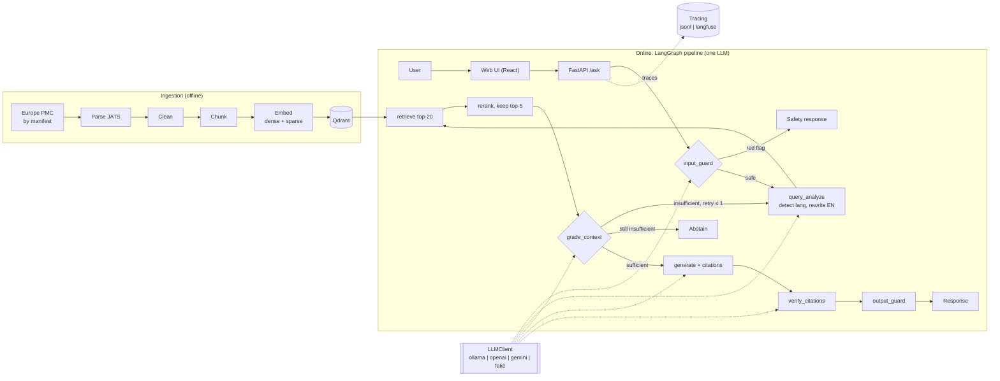

# AntiBros

[](https://github.com/duclld1709/AntiBros/actions/workflows/ci.yml)
[](LICENSE)
[](pyproject.toml)

**Evidence-based answers about protein and creatine, with a citation on every claim and an
honest "not enough evidence" when the papers don't say.**

Gym advice online is full of bro-science, and general-purpose chatbots answer fluently
without saying where a claim comes from. AntiBros answers Vietnamese or English questions
from 12 open-access papers.
- **Cited answers.** Hybrid/dense retrieval, cross-encoder reranking and an evidence grade
  feed generation. Every claim carries a code-numbered citation, and an LLM check of each
  claim drops unsupported ones.
- **Abstains and redirects.** It abstains when evidence is missing, and medical red flags
  are redirected before any retrieval.
- **Measured.** It was evaluated on a frozen evalset with a pre-registered plan. On the
  held-out test split, the full pipeline **did not beat the simpler baseline** on any
  primary metric. Both abstain too often (false-abstain rate 0.74 and 0.70). The safety
  guard caught 12/12 red flags at FPR 0.083 [0.000, 0.250]
  ([final evaluation](reports/final_evaluation.md),
  [error analysis](reports/error_analysis.md)).

> AntiBros gives information from research papers, not medical advice. Ask a doctor before
> changing supplements, especially with a health condition, medication, pregnancy, or if you
> are under 18.

**Demo video (≈2 min):** TBD. To be recorded on the laptop (Vietnamese cited answer, a
myth, an abstention, a red-flag redirect, the trace and the benchmark).

## Architecture



Every step is a config toggle, and a disabled step is not a node of the compiled graph
([ADR-0021](docs/adr/0021-m4-pipeline-composition.md)). `configs/baseline.yaml` is
retrieve → generate; `configs/full.yaml` enables every step.

## Quickstart (one command, Docker Desktop)

```powershell
Copy-Item .env.example .env      # Linux/macOS: cp .env.example .env
docker compose up
```

- **Services:** `qdrant` starts first. `init` then downloads the 12 papers from Europe PMC
  (sha256-checked) and indexes them. `api` serves the API and the web UI on
  **http://localhost:8000**.
- **LLM:** on Windows the API calls native **Ollama** at `host.docker.internal`, so pull the
  models in [`configs/models/laptop.yaml`](configs/models/laptop.yaml) first. On Linux
  without native Ollama, run `docker compose --profile ollama up` and set
  `LLM_BASE_URL_DOCKER=http://ollama:11434/v1`.
- **Other providers:** point `ANTIBROS_MODELS` in `.env` at another model profile
  (`openai_compatible`, `gemini`); no code change.
- **Offline check:** `uv run python scripts/fresh_clone_test.py` clones the repo, runs the
  stack with fake models on a 3-paper CC BY mini corpus, and checks `/health`, a cited
  answer and a red-flag redirect.

### Without Docker (Windows, PowerShell)

```powershell
uv sync
uv run antibros ingest
uv run antibros index --config configs/full.yaml --chunker section_aware --embedder e5_large
uv run poe ui-build
uv run antibros serve --config configs/full.yaml --models configs/models/laptop.yaml
```

Setup details: [docs/setup_windows.md](docs/setup_windows.md). Common commands are listed in
[CLAUDE.md §3](CLAUDE.md).

## Benchmark (golden test split, run once with a pre-registered plan)

Pipeline `qwen3.5:4b` Q4_K_M, judge `gemma4:e4b` Q4_K_M, temperature 0, Ollama. Run
2026-10-20 on a **Tesla V100 16 GB** (Linux), a recorded deviation from the RTX 3050
laptop. 30 golden + 24 safety test questions; 95% bootstrap CIs.
Runs: [`baseline`](experiments/final-c01d215e_baseline_test/),
[`full`](experiments/final-c01d215e_full_test_rerun1/),
[`guard`](experiments/final-c01d215e_guard_test/);
[paired comparison](experiments/final-c01d215e_comparison.md).

| Metric | baseline | full | full − baseline (paired) | Target |
|---|---|---|---|---|
| Evidence Recall@10 | 0.729 [0.653, 0.801] | 0.737 [0.642, 0.830] | +0.005 [−0.078, +0.099] n.s. | ≥ 0.80 |
| Faithfulness (answered items) | 0.936 [0.886, 0.979] (n = 7) | 0.967 [0.950, 0.983] (n = 6) | −0.017 [−0.050, +0.000] n.s. (n = 3) | ≥ 0.75 |
| Citation precision (answered items) | 0.957 [0.929, 0.986] (n = 7) | 0.992 [0.975, 1.000] (n = 6) | −0.017 [−0.050, +0.000] n.s. (n = 3) | ≥ 0.75 |
| Abstention F1 | 0.414 [0.160, 0.606] | 0.452 [0.214, 0.647] | +0.038 [−0.074, +0.177] n.s. | ≥ 0.70 |
| False-abstain rate (answerable/myth) | 0.696 [0.522, 0.870] | 0.739 [0.565, 0.913] | +0.043 [−0.174, +0.261] n.s. | — |
| Citation validity | 1.000 | 1.000 | — | — |
| Red-flag recall / FPR (safety test) | — | 1.000 / 0.083 [0.000, 0.250] | — | ≥ 0.90 / ≤ 0.15 |

The answers that are given are faithful and correctly cited, but too few are given. Of the
35 wrong test items, 24 are invalid JSON from the 4B generator, 7 are an over-strict
evidence grade and 3 are guard false positives ([error analysis](reports/error_analysis.md)).

## Ablations (dev)

[`reports/ablation.md`](reports/ablation.md) has CI tables and figures for every axis.
- **Retrieval:** dense retrieval beat hybrid and sparse. e5-large matched bge-m3 on recall
  with better MRR. The reranker improved ranking.
- **Leave-one-out:** removing the reranker significantly lowered Evidence Recall@10
  (−0.195 [−0.330, −0.070]). Query rewrite and verify showed no effect on dev.
- **Guard:** `rule_llm` matched the LLM-only guard's recall at a fraction of its latency.

Dev has 16 questions, so these are directions, not conclusions.

## Engineering under constraints

- **One 6 GB GPU for everything.** The pipeline LLM (4.0 GB at 8k context), bge-m3 and the
  reranker fit with 323 MiB headroom. The judge (4.5 GB) never shares VRAM with the
  pipeline LLM: eval runs `predict` → unload → `judge`
  ([hardware report](reports/hardware.md), [ADR-0012](docs/adr/0012-single-pipeline-llm-separate-judge.md)).
- **Eval in ≤ 10–20 minutes per command.** All dev and test runs met the budget (each run's
  `timing.json`); the test steps took 311 s, 275 s and 20 s.
- **Pre-registered evaluation.**
  - The hypotheses, the configs (sha256), the model digests and the guard-selection rule
    were locked before test ([`final_eval_plan.yaml`](configs/final_eval_plan.yaml)).
  - `antibros eval final` is the only way to run the test split. It refuses on any
    mismatch and logs every run to [`test_runs.log`](experiments/test_runs.log).
  - One infrastructure re-run is allowed, and is recorded in
    [`deviations.md`](experiments/deviations.md)
    ([ADR-0014](docs/adr/0014-preregistered-final-evaluation.md)).
- **Model-written, leak-checked evalset.** The evalset was written by Claude Code, verified
  by two cross-family models and frozen by checksum. `leakcheck` blocks any evalset 8-gram
  in code, configs, prompts or UI ([data card](evalsets/v1/DATA_CARD.md)).

## Design decisions (ADRs)

| # | Decision | Status |
|---|---|---|
| [0001](docs/adr/0001-vector-store-qdrant.md) | Qdrant as vector store | Accepted |
| [0002](docs/adr/0002-hybrid-retrieval-rrf.md) | Hybrid retrieval with RRF | Rejected (dense on dev) |
| [0003](docs/adr/0003-embedding-bge-m3.md) | bge-m3 embeddings | Rejected (e5-large) |
| [0004](docs/adr/0004-section-aware-chunking.md) | Section-aware chunking | Accepted |
| [0005](docs/adr/0005-orchestration-langgraph.md) | LangGraph orchestration | Accepted |
| [0006](docs/adr/0006-citation-verification.md) | Post-hoc citation verification | Accepted |
| [0007](docs/adr/0007-abstain-policy.md) | Abstain policy and thresholds | Accepted, revisit triggered by test |
| [0008](docs/adr/0008-open-access-data-only.md) | Open-access data only | Accepted |
| [0009](docs/adr/0009-frozen-evalsets-and-milestone-tags.md) | Frozen evalsets, milestone tags | Accepted |
| [0010](docs/adr/0010-model-only-annotation.md) | Evalset written by Claude Code, no human review | Accepted |
| [0011](docs/adr/0011-local-llms-provider-agnostic-client.md) | Local LLMs, provider-agnostic client | Accepted |
| [0012](docs/adr/0012-single-pipeline-llm-separate-judge.md) | One pipeline LLM, cross-family judge | Accepted |
| [0013](docs/adr/0013-laptop-only-small-corpus-eval-budget.md) | Laptop only, small corpus, eval budget | Accepted |
| [0014](docs/adr/0014-preregistered-final-evaluation.md) | Pre-registered final evaluation | Accepted |
| [0015](docs/adr/0015-evidence-span-relevance.md) | Evidence-span relevance labels | Accepted |
| [0016](docs/adr/0016-native-windows-development.md) | Native Windows development | Accepted |
| [0017](docs/adr/0017-ollama-native-adapter.md) | Ollama native adapter | Accepted |
| [0018](docs/adr/0018-jats-cleaning-and-evidence-level-rules.md) | JATS cleaning, evidence levels | Accepted |
| [0019](docs/adr/0019-evalset-verifier-qwen35-4b.md) | Qwen 3.5 4B as evalset verifier | Accepted |
| [0020](docs/adr/0020-llm-judge-scoring.md) | Separate LLM judge | Accepted |
| [0021](docs/adr/0021-m4-pipeline-composition.md) | Pipeline composition, config inheritance, fallbacks | Accepted |
| [0022](docs/adr/0022-react-web-ui.md) | React (Vite) web UI | Accepted |

## Learn from this repo

The project was built milestone by milestone. Each brief in
[`docs/milestones/`](docs/milestones/) has goals, tasks, acceptance criteria and
self-check questions. Tags `m0`…`m6` mark the end of each milestone:
1. Check out the previous tag.
2. Build the milestone yourself.
3. Compare with `git diff m3 m4` (or the relevant pair).
4. Score yourself with the same frozen `evalsets/v1` and `antibros eval`. Results compare
   only with the same judge model; see the fingerprint.

The full specification is [PROJECT_SPEC.md](PROJECT_SPEC.md) (Vietnamese).

## Limitations

- **Narrow corpus:** 12 open-access papers on protein and creatine. The results say nothing
  about fitness questions in general.
- **Evalset written by a model:** Claude Code wrote every question, and two local models
  verified them; no human reviewed the labels. The judge and the pipeline model were also
  the two verifiers.
- **Small test set:** 30 golden and 24 safety questions, so most differences are not
  significant. Judge metrics rest on 3–7 answered items.
- **Self-verification bias:** the pipeline LLM checks its own citations, and judge scores
  are model judgments.
- **Evaluation environment:** the test run used a V100, not the target laptop. The
  baseline embedded its queries with CPU torch, and thresholds were tuned with a smaller
  generator ([deviations](reports/final_evaluation.md#deviations-from-the-plan)).
- **Data and licences:** Europe PMC open-access articles only, each with its licence
  recorded (10 CC BY, 1 CC BY-NC, 1 CC BY-NC-ND). `data/` is not redistributed; `docker
  compose up` downloads it.
- **Medical disclaimer:** not medical advice; see the note at the top.

## License

Code: [MIT](LICENSE). Article texts belong to their authors under their own open-access
licences ([corpus manifest](evalsets/v1/corpus_manifest.jsonl)).
