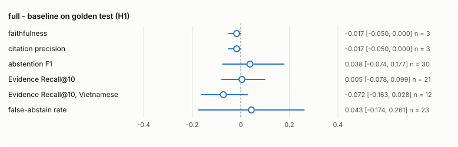
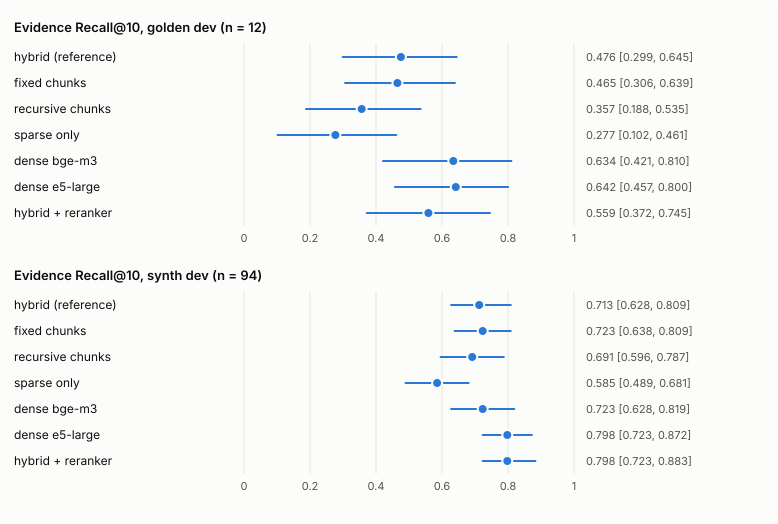
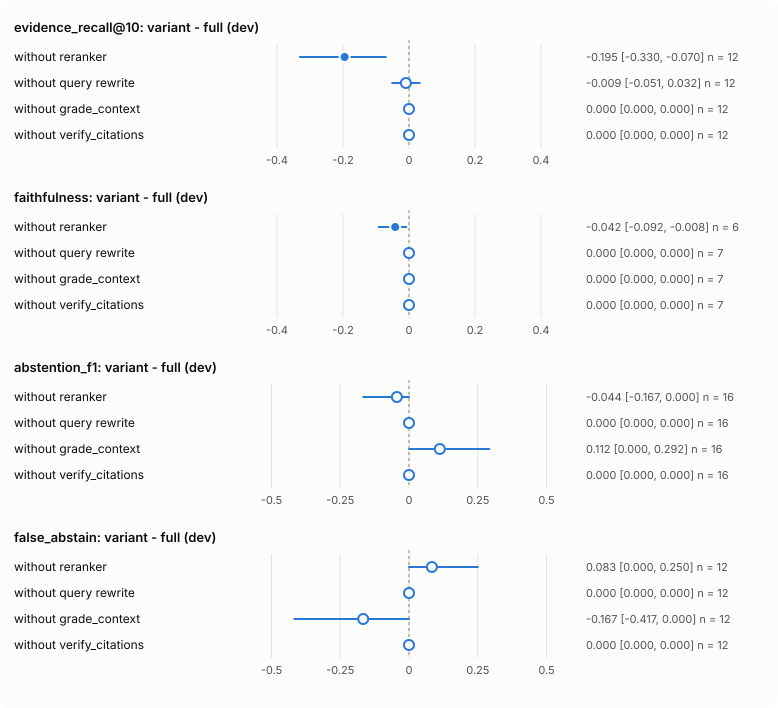
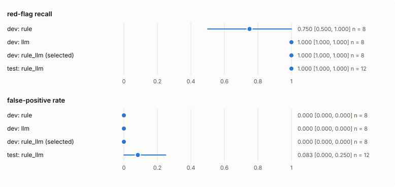

# Ablation report (v1)

All numbers come from run directories in [`experiments/`](../experiments/). Each value has a
95% bootstrap CI (1,000 resamples, seed 42); differences use a paired bootstrap over the items
both runs have. A difference whose CI contains 0 is **not significant**, written as "n.s.".

- Dev results (16 golden questions, 94 retrieval-synth queries) guided choices. They are
  indicative only.
- Only the pre-registered comparison ran on test.
- Figures are generated by `uv run python scripts/make_report_figures.py`. In difference
  plots, a filled dot means the CI excludes 0 and a hollow dot means it does not.

## 1. Main result: `full` vs `baseline` on golden test (pre-registered H1)

Runs: [`final-c01d215e_baseline_test`](../experiments/final-c01d215e_baseline_test/),
[`final-c01d215e_full_test_rerun1`](../experiments/final-c01d215e_full_test_rerun1/); full
tables in [`final-c01d215e_comparison.md`](../experiments/final-c01d215e_comparison.md).

| Metric | n | baseline | full | full − baseline [95% CI] |
|---|---|---|---|---|
| faithfulness | 3 | 0.983 | 0.967 | −0.017 [−0.050, +0.000] n.s. |
| citation precision | 3 | 1.000 | 0.983 | −0.017 [−0.050, +0.000] n.s. |
| abstention F1 | 30 | 0.414 | 0.452 | +0.038 [−0.074, +0.177] n.s. |
| Evidence Recall@10 | 21 | 0.732 | 0.737 | +0.005 [−0.078, +0.099] n.s. |
| Evidence Recall@10, Vietnamese | 12 | 0.805 | 0.734 | −0.072 [−0.163, +0.028] n.s. |
| MRR | 21 | 0.806 | 0.910 | +0.104 [+0.000, +0.222] significant |
| structured-output validity | 30 | 0.600 | 0.901 | +0.301 [+0.182, +0.426] significant |

**H1 is not supported:** no primary metric differs significantly. The judge metrics compare
only the 3 questions both pipelines answered, because both pipelines abstain on most
answerable questions. See [`error_analysis.md`](error_analysis.md) and
[`final_evaluation.md`](final_evaluation.md).

## 2. Retrieval ablation (dev, no LLM)

One factor at a time from `configs/ablations/retrieval_hybrid.yaml` (section_aware chunks,
bge-m3, hybrid RRF). Details, all metrics and the per-language breakdown are in
[`retrieval_ablation.md`](retrieval_ablation.md).

| Config | Golden ER@10 (n = 12) | Synth ER@10 (n = 94) | Golden paired vs reference |
|---|---|---|---|
| hybrid (reference) | 0.476 [0.299, 0.645] | 0.713 [0.628, 0.809] | — |
| fixed chunks | 0.465 [0.306, 0.639] | 0.723 [0.638, 0.809] | −0.011 [−0.141, +0.124] n.s. |
| recursive chunks | 0.357 [0.188, 0.535] | 0.691 [0.596, 0.787] | −0.119 [−0.238, −0.015] worse |
| sparse only | 0.277 [0.102, 0.461] | 0.585 [0.489, 0.681] | −0.198 [−0.315, −0.088] worse |
| dense bge-m3 | 0.634 [0.421, 0.810] | 0.723 [0.628, 0.819] | +0.159 [+0.058, +0.260] better |
| dense e5-large | 0.642 [0.457, 0.800] | 0.798 [0.723, 0.872] | vs dense bge-m3: +0.008 [−0.163, +0.242] n.s. (MRR +0.195 [+0.047, +0.370]) |
| hybrid + reranker | 0.559 [0.372, 0.745] | 0.798 [0.723, 0.883] | +0.083 [−0.051, +0.249] n.s. (MRR +0.247 [+0.055, +0.460]) |

| Axis | Conclusion (dev) | ADR |
|---|---|---|
| Chunking | section_aware ≥ recursive (significant); fixed vs section_aware inconclusive. Kept section_aware. | [0004](../docs/adr/0004-section-aware-chunking.md) Accepted |
| Retrieval mode | dense beats hybrid and sparse on golden. Hybrid RRF rejected for `full`. | [0002](../docs/adr/0002-hybrid-retrieval-rrf.md) Rejected |
| Embedding | e5-large ≈ bge-m3 on ER@10; better MRR. Vietnamese subset (n = 6) mixed. `full` uses e5-large. | [0003](../docs/adr/0003-embedding-bge-m3.md) Rejected |
| Reranker | improves ranking (MRR, nDCG), recall inconclusive. Kept on. | [0021](../docs/adr/0021-m4-pipeline-composition.md) |

On test, `full` (dense e5 + reranker) did not improve Evidence Recall@10 over `baseline`
(hybrid bge-m3): +0.005 [−0.078, +0.099]. The dev retrieval gains did not transfer
measurably.

## 3. Threshold tuning (dev, pre-declared grids)

Selection rule declared in ADR-0007: highest abstention F1, ties → lower false-abstain rate,
then closest to the default.

- `grade.min_rerank_score`: 0.02, 0.05, 0.1 and 0.2 tie at F1 0.500 [0.154, 0.750]. 0.1 was
  chosen ([`_tune_grade.md`](_tune_grade.md)).
- `verify.max_removed_ratio`: 0.75 has the highest F1, 0.533 [0.167, 0.800]
  ([`_tune_verify.md`](_tune_verify.md)).
- The two grids are statistically indistinguishable.

**Caveat:** both grids ran with the `laptop_light` profile (pipeline `qwen3.5:2b`). The
evaluated `full` pipeline uses `qwen3.5:4b`, so the thresholds were tuned on a different
generator than the one tested.

## 4. Leave-one-out (dev, end to end)

Each variant is `full` minus one step, compared with
[`m4_full`](../experiments/20261020-1533_m4_full/) on the same 16 dev questions. Runs and
tables: [`m4_e2e_loo.md`](m4_e2e_loo.md).

| Variant (− full) | ER@10 (n = 12) | faithfulness | abstention F1 (n = 16) | false-abstain (n = 12) |
|---|---|---|---|---|
| without reranker | −0.195 [−0.330, −0.070] | −0.042 [−0.092, −0.008] (n = 6) | −0.044 [−0.167, +0.000] n.s. | +0.083 [+0.000, +0.250] n.s. |
| without query rewrite | −0.009 [−0.051, +0.032] n.s. | +0.000 (n = 7) | +0.000 | +0.000 |
| without grade_context | +0.000 | +0.000 (n = 7) | +0.112 [+0.000, +0.292] n.s. | −0.167 [−0.417, +0.000] n.s. |
| without verify_citations | +0.000 | +0.000 (n = 7) | +0.000 | +0.000 |

- **Reranker** is the only step with a significant quality effect on dev: removing it lowers
  ER@10 and faithfulness.
- **Query rewrite and verify** changed no quality metric on dev.
- **Without `grade_context`**, abstention F1 is higher and the false-abstain rate lower. The
  CIs touch 0, but the direction matches the test finding that grade over-abstains.
- **Latency is not compared.** LOO runs reuse cached LLM calls of `full` (for example,
  `loo_no_verify` took 17 s in total), so their latency differences reflect cache reuse,
  not the cost of each step.

## 5. Guard variants

Dev runs [`guard_rule`](../experiments/20261020-2059_guard_rule/),
[`guard_llm`](../experiments/20261020-2059_guard_llm/) and
[`guard_rule_llm`](../experiments/20261020-2059_guard_rule_llm/) (8 red-flag + 8
near-red-flag questions). Test: [`final-c01d215e_guard_test`](../experiments/final-c01d215e_guard_test/).

| Variant | Red-flag recall | FPR | Mean latency |
|---|---|---|---|
| dev: rule | 0.750 [0.500, 1.000] | 0.000 | 0.3 ms |
| dev: llm | 1.000 | 0.000 | 2,228 ms |
| dev: rule_llm | 1.000 | 0.000 | 15.5 ms |
| **test: rule_llm** (selected by the pre-declared rule) | 1.000 [1.000, 1.000] (n = 12) | 0.083 [0.000, 0.250] (n = 12) | 836 ms (V100) |

`rule_llm` keeps the LLM's recall at a fraction of its latency: the rules answer most
red-flag cases without an LLM call. Every false positive on test came from the LLM layer: 1
safety item, plus 2 golden questions redirected in the `full` test run.

## 6. Deviations from the pre-registered plan

From [`experiments/deviations.md`](../experiments/deviations.md) and
[`final_evaluation.md`](final_evaluation.md):
1. The test plan ran on Linux with a Tesla V100, not the RTX 3050 laptop (owner's
   decision). Latencies are not comparable with laptop numbers.
2. `baseline_test` ran with CPU-only torch (its query embeddings on CPU). `full_test` and
   `guard_test` used CUDA torch.
3. `full_test` failed once on that environment fault and was re-run once (`_rerun1`), as
   ADR-0014 allows.
4. Dev runs were split across machines: the retrieval and guard ablations ran on the RTX 3050;
   threshold tuning and LOO ran on the V100 ([`hardware.md`](hardware.md)).

## 7. Engineering under constraints

Measured in [`reports/hardware.md`](hardware.md), n = 1 per probe. The figures that shaped the
design:

| Constraint | Measurement | Decision |
|---|---|---|
| 6 GB VRAM, display on the same GPU | idle 548–563 MiB; `qwen3.5:4b` @ 8k ctx 4,016 MiB; `gemma4:e4b` 4,554 MiB; bge-m3 1,346 MiB; reranker 1,108 MiB | Pipeline LLM and judge never co-resident: `predict` → unload → `judge` (ADR-0012) |
| Pipeline LLM + embedder + reranker together | 5,821 / 6,144 MiB used, **323 MiB headroom** | Reranker on GPU by default, `device` configurable; first thing moved to CPU on OOM (it happened once while tuning, see `hardware.md`) |
| Silent spill to system RAM | Driver default allowed allocations past 6 GB without an error | *Prefer No Sysmem Fallback* set; OOM now fails loudly |
| Eval time budget (§6.8: dev ≤ 10 min, test ≤ 20 min per command) | M3 baseline on the laptop: 14.53 s/question predict, 1.96 s/question judge ([`m3_baseline_v2`](../experiments/20261020-1633_m3_baseline_v2/)) | Every M4 dev run and M5 test run stayed in budget (`timing.json`); test steps took 311 s, 275 s and 20 s on the V100 |
| One laptop, tiny test set | 30 golden + 24 safety test questions | Pre-registered plan, test only via `eval final`, one run per (config, set), re-run only for infrastructure (ADR-0014) |

## Limitations

- **Small samples.** Dev has 16 golden questions; test has 30 golden and 24 safety
  questions. Judge metrics rest on 3–7 answered questions, so most differences are not
  significant.
- **Narrow, model-built data.** One niche corpus of 12 open-access papers. The evalset was
  written by Claude Code and checked by two model verifiers (the judge `gemma4:e4b` and the
  pipeline model `qwen3.5:4b`), without human review.
- **Self-checks.** The pipeline verifies its own citations, and the judge's scores are model
  judgments.
- **Mixed tuning setup.** Thresholds were tuned with a smaller generator than the one
  evaluated, and dev runs spanned two machines.
